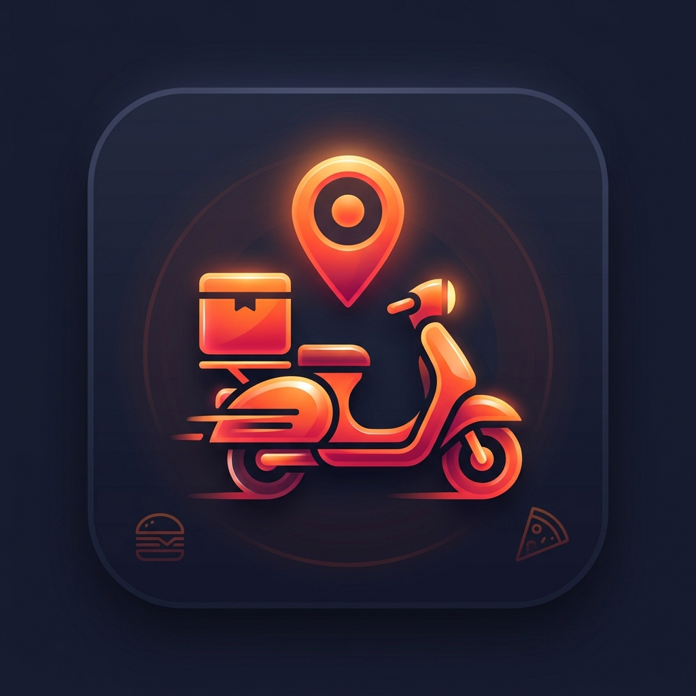
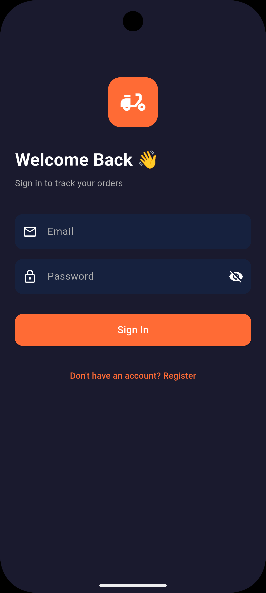
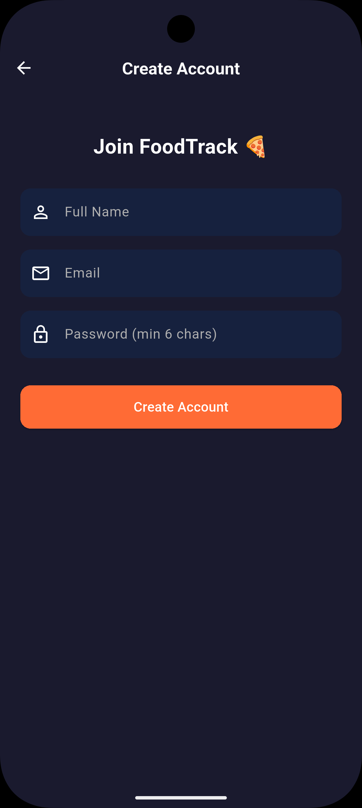
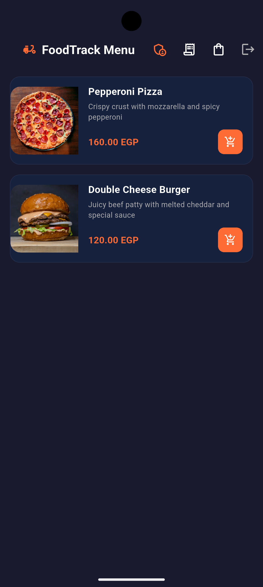
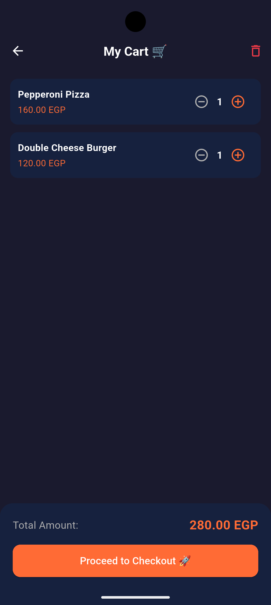
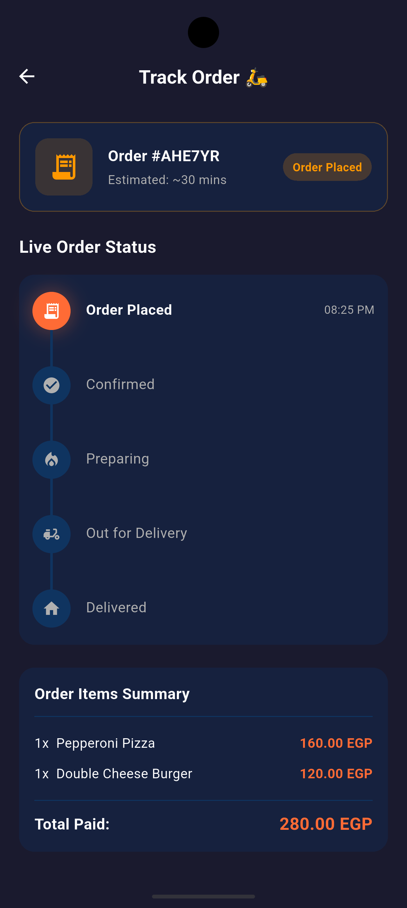
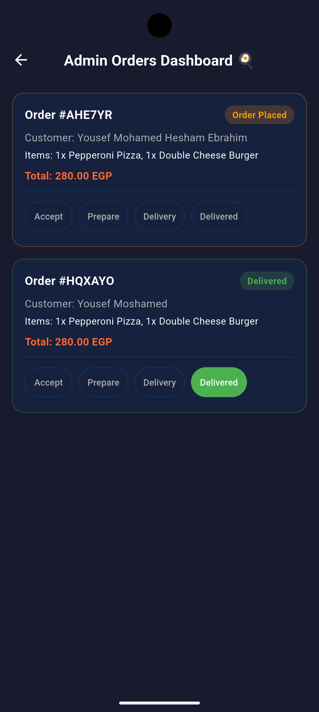
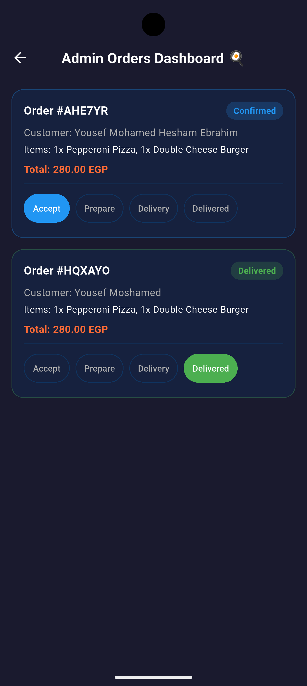
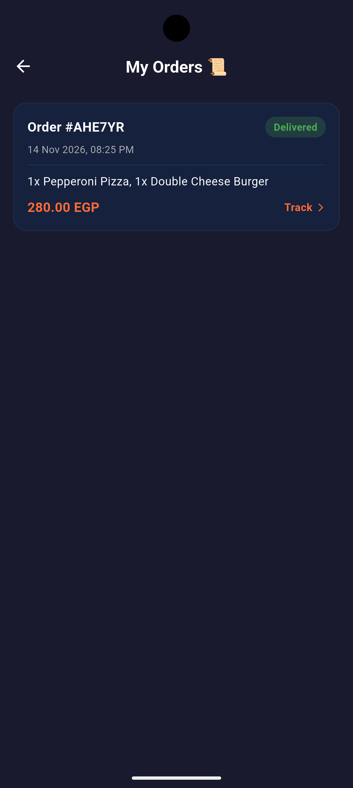

# 🛵 FoodTrack — Real-time Food Order Status Tracker

<p align="center">
  
</p>

<p align="center">
  <b>A production-grade, real-time Food Delivery & Order Tracking Flutter application built with Clean Architecture, BLoC State Management, and Firebase Firestore live Streams.</b>
</p>

<p align="center">
  
  
  
  
  
</p>

---

## 🌟 Key Highlights & Engineering Features

- ⚡ **Zero-latency Real-time Sync**: Uses Cloud Firestore `.snapshots()` streams and `StreamSubscription` in BLoC to broadcast order status transitions instantly without any polling or manual screen refreshes.
- 🏗️ **Enterprise Clean Architecture**: Strict separation of concerns divided into **Domain**, **Data**, and **Presentation** layers adhering to the Dependency Inversion Principle.
- 📱 **Dual-Role Workflow (Customer & Restaurant Admin)**:
  - **Customer**: Browse food catalog, manage in-memory persistent cart, place orders, and follow an animated live tracking timeline.
  - **Admin**: Dedicated live dashboard to inspect incoming orders and update delivery phases with one click.
- ⏳ **Status History Audit Trail**: Tracks and stores every state progression (`pending`, `confirmed`, `preparing`, `out_for_delivery`, `delivered`) with its exact ISO timestamp.
- 🎨 **Modern Dark UI & Fluid Animations**: Custom dark-themed layout featuring glowing pulsing animations on active order steps.

---

## 🔄 Real-time Order Life Cycle

```
[ Customer Places Order ] 
           │
           ▼
    (1) Pending ──► (2) Confirmed ──► (3) Preparing ──► (4) Out for Delivery ──► (5) Delivered
           │
     Admin Accepts     Kitchen Prepares      Courier Picks Up           Customer Receives
```

---

## 📐 Architecture Overview

The application strictly adheres to Uncle Bob's **Clean Architecture** patterns:

```
lib/
├── core/
│   ├── constants/       # Collection names, order statuses
│   ├── errors/          # Custom Exceptions & Failure definitions
│   ├── theme/           # Dark mode styling & color palettes
│   └── utils/           # Status color/icon resolvers & formatters
│
├── features/
│   ├── auth/            # Authentication (Entities, Repositories, BLoC, Login/Register)
│   ├── menu/            # Menu Catalog (Firestore DataSources, BLoC, UI cards)
│   ├── cart/            # In-memory session cart management
│   └── orders/          # Real-time Order Placement, Tracking Stepper, Admin Dashboard
│
├── injection_container.dart  # Service Locator (GetIt) setup
└── main.dart                 # App Entrypoint & MultiBlocProvider
```

---

## 🗄️ Database Schema (Cloud Firestore)

### `users` Collection
```json
{
  "id": "USER_UID",
  "name": "Yousef Hesham",
  "email": "yousef@example.com",
  "role": "customer"
}
```

### `menu_items` Collection
```json
{
  "name": "Double Cheese Burger",
  "description": "Juicy beef patty with melted cheddar and special sauce",
  "price": 120.0,
  "category": "Burgers",
  "imageUrl": "https://images.unsplash.com/photo-1568901346375-23c9450c58cd?w=500"
}
```

### `orders` Collection
```json
{
  "customerId": "USER_UID",
  "customerName": "Yousef Hesham",
  "totalPrice": 240.0,
  "status": "preparing",
  "estimatedTime": 30,
  "createdAt": "Timestamp",
  "items": [
    { "id": "ITEM_1", "name": "Double Cheese Burger", "price": 120.0, "quantity": 2 }
  ],
  "statusHistory": [
    { "status": "pending", "timestamp": "Timestamp" },
    { "status": "confirmed", "timestamp": "Timestamp" },
    { "status": "preparing", "timestamp": "Timestamp" }
  ]
}
```

---

## 🚀 Getting Started

### 1. Prerequisites
- [Flutter SDK](https://flutter.dev/docs/get-started/install) (>= 3.3.0)
- A Firebase project with **Authentication (Email/Password)** and **Cloud Firestore** enabled.

### 2. Setup Firebase
1. Place your `google-services.json` inside the `android/app/` directory.
2. Run `flutter pub get`.

### 3. Generate App Icons (Optional)
```bash
dart run flutter_launcher_icons
```

### 4. Run the Project
```bash
flutter run
```

---

## 💼 Resume Pitch

> **FoodTrack — Real-time Food Delivery & Live Order Status Tracker (Flutter, Firebase, BLoC)**
> - Engineered a real-time reactive order tracking system using Flutter and Cloud Firestore `.snapshots()` streams, eliminating manual page reloads.
> - Structured codebase using Clean Architecture (Domain, Data, Presentation) and BLoC pattern for robust state management.
> - Implemented dual-role system (Customer & Restaurant Admin) allowing admins to manipulate stages (`pending` → `delivered`) with immediate client-side timeline reflection.
> - Integrated GetIt for dependency injection and automated launcher icon pipelines.

---

## 👨‍💻 Author
**Yousef Hesham**  
- GitHub: [@Yousef-Hesham5839](https://github.com/Yousef-Hesham5839)


## 📱 App Screenshots & User Journey

### 👤 Customer Experience (Browse, Cart & Tracking)
| 1. Login | 2. Register | 3. Food Menu |
| :---: | :---: | :---: |
|  |  |  |

| 4. Cart & Checkout | 5. Live Tracking (Preparing) | 6. Live Tracking (Delivered) |
| :---: | :---: | :---: |
|  |  |  |

### 🍳 Restaurant Admin & History
| 7. Admin Dashboard | 8. Order Status Update | 9. My Orders History |
| :---: | :---: | :---: |
|  |  |  |